# CLAUDE.md — Rapport de Direction Technique, Architecture SI & Mandat d'Audit (Par Antigravity pour Claude Code)

> **Destinataire** : **Claude Code** (Agent IA d'Ingénierie Logicielle & d'Architecture)
> **Expéditeur** : **Antigravity** (Expert Management, Gouvernance SI & Co-Architecte IA)
> **Propriétaire du Projet** : **Kouroufia** (`kouroufia15@gmail.com`)
> **Répertoire Local Strict** : `C:\Users\RO2TK\OneDrive\Bureau\Pro\Antigravity\Assistant de Briefing Quotidien (Inspiré de Google CC) - Antigravity`

---

## 1. Mot de cadrage managérial & Mandat de mission pour Claude Code

Bienvenue sur le projet **Assistant de Briefing Quotidien (Inspiré de Google CC)**.
En tant qu'expert du management et co-pilote IA sur cet environnement, je te transmets par ce document **l'intégralité des clés du Système d'Information (SI)**, des accès, des comptes, des règles métier et de l'architecture technique afin que tu puisses opérer avec une efficacité maximale.

### Ton Mandat Officiel (Ordre de Mission)
L'utilisateur te confie le projet en local avec **toutes les autorisations nécessaires** :

1. **Analyser par toi-même l'intégralité du projet** : Inspecte en profondeur chaque fichier de `src/` ainsi que les fichiers de configuration à la racine.
2. **Réaliser un diagnostic complet et vérifier toutes les erreurs (Audit 360°)** :
   - Traquer les erreurs logiques, les incohérences de taxonomie/catégories, les risques de dépassement de la limite d'exécution de 6 minutes de Google Apps Script, la gestion des exceptions, le décodage HTML/UTF-8 et les valeurs codées en dur.
3. **Améliorer significativement l'outil** :
   - Rendre le projet **meilleur, propre, modulaire, bien structuré et garanti sans erreurs**.
   - Optimiser la performance et la résilience tout en respectant **scrupuleusement** toutes les règles métier définies dans `AGENTS.md`.
   - Déployer chaque amélioration validée via **Git (`git push origin main`)** et **Clasp (`npx clasp push --force`)**.

---

## 2. Vision Globale & Architecture du Système d'Information (SI)

### 2.1 Finalité du SI
Le système est un **agent exécutif autonome serverless** hébergé sur **Google Apps Script (Runtime V8, fuseau `Europe/Paris`)**. Chaque matin à **06h00:00 pile**, il collecte, nettoie, recoupe et résume via l'API **Google Gemini** l'ensemble de l'écosystème informationnel de Kouroufia pour lui livrer par e-mail un briefing matinal complet et lisible en 2 minutes :
1. **Actions prioritaires (Top of Mind)** issues des e-mails non lus nécessitant une action humaine, avec temps estimé et échéance.
2. **Récapitulatif catégorisé des e-mails non lus** (avec désambiguïsation stricte LinkedIn, emploi, administration, banque, santé, etc.).
3. **Planning du jour (Google Calendar)** avec extraction automatique des liens de visioconférence (Google Meet, Zoom, Microsoft Teams) et détection de la ville de déplacement.
4. **Météo dynamique & Conseil vestimentaire** (basée sur la ville de l'agenda ou par défaut `Annemasse` via `wttr.in`), structurée en Matin (9h) / Après-midi (15h) / Soir (21h).
5. **Les Actus du Jour — Synthèse HugoDécrypte** (extraction de la dernière vidéo longue YouTube, chapitrage horodaté, enrichissement par les articles de presse en description ; source unique YouTube @hugodecrypteactus, sans Acast depuis le 14/11/2026).
6. **Complément d'actualités issu de Google Actualités** structuré selon **9 rubriques PESTEL+ normalisées**, avec corroboration multi-sources pour garantir une précision journalistique maximale (villes exactes, fonctions des personnes, explication des sigles).
7. **Rapport de l'Agent de Contrôle & Bon Fonctionnement** (`DevOpsAgentService`), un ingénieur SRE/DevOps virtuel déterministe qui audite et auto-répare les checkpoints, les verrous et les déclencheurs avant chaque exécution.

### 2.2 Schéma d'Architecture du SI (Mermaid)

```mermaid
flowchart TB
    subgraph DEV["1. Environnement Local & CI/CD (Poste Windows)"]
        LOCAL["Répertoire Local Unique\n(Git + Node.js + Clasp)"]
        AGENTS_MD["AGENTS.md & CLAUDE.md\n(Gouvernance & Règles Métier)"]
        GH["GitHub Repository\nkourf/google-cc-briefing-agent (main)"]
        LOCAL <-->|"git push / pull"| GH
    end

    subgraph GAS["2. Plateforme Serverless Google Apps Script (Runtime V8 - Europe/Paris)"]
        CLASP_SYNC["Déploiement Clasp\nScript ID: 1q83o0v..."]
        LOCAL ==>|"npx clasp push --force"| CLASP_SYNC

        subgraph TRIGGERS["Ordonnancement & Résilience Horaire"]
            T_MAIN["Déclencheur Précis 06:00:00\n(runDailyBriefing)"]
            T_WATCH["Watchdog de Sécurité 07:00\n(watchdogSafetyCheck)"]
            T_MANUAL["Entrées Manuelles / Diagnostic\n(runBriefingNow / reparerEtActiverBriefing / diagnostiquerBriefing)"]
        end

        subgraph CORE["Cœur Applicatif & Services Métier (src/)"]
            CODE["Code.js\n(Orchestrateur d'Entrée)"]
            DEVOPS["DevOpsAgentService.js\n(Auto-Réparation & Audit SRE)"]
            STATE["StateService.js\n(LockService & Checkpoints)"]
            CFG["Config.js\n(ScriptProperties & Constantes)"]
            BRIEF["BriefingService.js\n(Assemblage, Routeur & Envoi)"]
            TPL["Template.html + PlainText\n(Rendu Email Responsive)"]
            UTILS["Utils.js\n(Sanitization, Décodage HTML, URLs)"]
        end

        subgraph CONNECTORS["Connecteurs de Données Internes & Externes"]
            GMAIL_S["GmailService.js"]
            CAL_S["CalendarService.js"]
            WEATHER_S["WeatherService.js"]
            NEWS_S["NewsService.js"]
            GEMINI_S["GeminiService.js"]
        end
    end

    subgraph EXT["3. Écosystème Google & Sources Externes (APIs & Flux)"]
        GMAIL_API[("Gmail Boîte Principale\nkouroufia15@gmail.com")]
        CAL_API[("Google Calendar\nAgenda Principal")]
        WTTR[("API Météo wttr.in\n(JSON format=j1)")]
        YT_HUGO[("YouTube XML Feed\n@hugodecrypteactus")]
        YT_PAGE[("YouTube page Vidéos\n@hugodecrypteactus/videos")]
        GNEWS[("Google Actualités RSS\n9 Flux PESTEL+ & Corroboration")]
        PRESS[("Sites de Presse Tiers\n(Extraction JSON-LD / HTML)")]
        GEMINI_API[["Google Gemini API (v1beta)\nCascade: 3.1-flash-lite -> 3.5-flash-lite -> ..."]]
    end

    T_MAIN --> CODE
    T_WATCH --> CODE
    T_MANUAL --> CODE

    CODE --> DEVOPS
    CODE --> STATE
    CODE --> GMAIL_S
    CODE --> CAL_S
    CODE --> GEMINI_S
    CODE --> BRIEF
    BRIEF --> WEATHER_S
    BRIEF --> NEWS_S
    BRIEF --> GEMINI_S
    BRIEF --> DEVOPS
    BRIEF --> TPL

    GMAIL_S <-->|"GmailApp (Batch RPC)"| GMAIL_API
    CAL_S <-->|"CalendarApp"| CAL_API
    WEATHER_S <-->|"UrlFetchApp"| WTTR
    NEWS_S <-->|"fetchUrlsSafely"| YT_HUGO
    NEWS_S <-->|"Dernière vidéo longue + chapitres"| YT_PAGE
    NEWS_S <-->|"fetchUrlsSafely"| GNEWS
    NEWS_S <-->|"Scraping Résilient"| PRESS
    GEMINI_S <-->|"JSON Schema / Cascade"| GEMINI_API
    BRIEF ==>|"GmailApp.sendEmail"| GMAIL_API
```



---

## 3. Accès, Comptes, Identifiants & Commandes de Déploiement

### 3.1 Emplacement Local Strict (Règle Absolue)
- **Répertoire de travail unique** :
  `C:\Users\RO2TK\OneDrive\Bureau\Pro\Antigravity\Assistant de Briefing Quotidien (Inspiré de Google CC) - Antigravity`
- **Interdiction formelle** : Ne jamais créer de dossiers ou fichiers sur le Bureau Windows parent ou ailleurs.

### 3.2 Identifiants Google Apps Script & Clasp
- **Fichier `.clasp.json`** :
  - `scriptId` : `1q83o0v-0wFqNF_z8VvL82cQjU2PsapNfuql2SBAVx8yppKvqV_YhILTo`
  - `rootDir` : `src`
- **Manifeste `src/appsscript.json`** :
  - `timeZone` : `Europe/Paris`
  - `runtimeVersion` : `V8`
  - `oauthScopes` : `gmail.readonly`, `gmail.send`, `calendar.readonly`, `script.external_request`, `script.scriptapp`.

### 3.3 Dépôt Git & GitHub
- **Remote `origin`** : `https://github.com/kourf/google-cc-briefing-agent.git`
- **Branche principale** : `main`

### 3.4 Comptes Utilisateur & Paramètres (`src/Config.js`)
- **Destinataire principal** : `kouroufia15@gmail.com` (Prénom : `Kouroufia`)
- **Comptes déclarés dans `Config.KNOWN_ACCOUNTS`** :
  1. `dramekouroufia.pro@gmail.com` (`Compte Pro`)
  2. `kouroufia15@gmail.com` (`Principal`)
  3. `dkouroufia27@outlook.fr` (`Ancien Perso`)
- **Ville météo par défaut** : `Annemasse`
- **Modèles Gemini (`Config.js` & `GeminiService.js`)** :
  - Primaire : `gemini-3.1-flash-lite`
  - Repli : `gemini-3.5-flash-lite`
  - Cascade : `gemini-3.1-flash-lite` -> `gemini-3.5-flash-lite` -> `gemini-3.6-flash` -> `gemini-3.5-flash` -> `gemini-2.5-flash-lite` -> `gemini-2.5-flash` -> `gemini-3.8-flash`.

### 3.5 Commandes de Synchronisation (Obligatoires après modification)
```bash
# 1. Vérifier la syntaxe JS localement
node --check src/Code.js src/Config.js src/BriefingService.js src/GeminiService.js src/GmailService.js src/CalendarService.js src/NewsService.js src/WeatherService.js src/DevOpsAgentService.js src/StateService.js src/TriggerService.js src/Utils.js

# 2. Pousser sur Google Apps Script
npx clasp push --force

# 3. Versionner et pousser sur GitHub
git add .
git commit -m "feat/fix: description claire"
git push origin main
```

---

## 4. Règles Métier Impératives (`AGENTS.md` — Non-Négociables)

1. **Météo & Conseil Vestimentaire** :
   - En-tête de ville obligatoire : `**Pour [Ville] :**`
   - Retour à la ligne obligatoire avant chaque moment : `Matin (9h) : ...`, `Après-midi (15h) : ...`, `Soir (21h) : ...`.
   - **Typographie chiffrée stricte** : Températures toujours en chiffres avec espace avant `°C` (ex. `10 °C`, jamais "dix degrés"). Pourcentages toujours en chiffres avec `%` (ex. `29%`, jamais "pour cent").
2. **Les Actus du Jour — Synthèse HugoDécrypte** :
   - Source : dernière vidéo longue publique de `https://www.youtube.com/@hugodecrypteactus/videos` (`channel_id=UCAcAnMF0OrCtUep3Y4M-ZPw`).
   - Exclure impérativement les Shorts (`/shorts/` ou `#shorts`).
   - Source unique YouTube (décision du 14/11/2026) : la page « Vidéos » désigne la dernière vidéo longue, le flux RSS ou la page de la vidéo fournit les chapitres. Ne jamais utiliser Acast ni renvoyer vers la chaîne. Chaque sujet de la vidéo est analysé et classé par rubrique PESTEL+, au même format que le Complément Google Actualités.
   - **Règles Anti-Vague** :
     - **Lieux précis** : Toujours nommer la ville ou commune exacte (ex. "Trappes" et non "en banlieue parisienne").
     - **Identités et fonctions** : Toujours donner le prénom, le nom ET la fonction ou le poste exact (ex. "Senny Mayulu (le jeune milieu de terrain du PSG)").
     - **Acronymes et entreprises décryptés** : Toujours expliciter les sigles et entreprises entre parenthèses.
3. **Complément Google Actualités** :
   - Intitulé exact de section : `Complément d'actualités issu de Google Actualités :`
   - **9 Catégories PESTEL+ Normalisées** :
     1. `P — Politique & Géopolitique`
     2. `E — Économie, Finance & Entreprises`
     3. `S — Social & Sociétal`
     4. `T — Technologie, IA & Innovation`
     5. `E — Environnement & Écologie`
     6. `L — Légal : Justice, Lois & Procès`
     7. `Culture & Savoir (Cinéma, Livres, Histoire & Sciences)`
     8. `Sport`
     9. `Faits divers (Délits, Crimes & Accidents marquants)`
   - Corroboration multi-sources via `fetchUrlsSafely`.
4. **Agent de Surveillance (`DevOpsAgentService`)** :
   - Nom officiel : `Agent de Contrôle & Bon Fonctionnement`.
   - **Règle Zéro Emoji** : Aucun emoji dans cette section ni dans le texte généré.
   - **Accessibilité non-technique** : Français clair et rassurant sans jargon d'ingénierie.

---

## 5. Pré-Diagnostic Technique d'Antigravity (Anomalies à Corriger par Claude Code)

Voici les **9 anomalies et pistes d'amélioration** identifiées lors de l'audit initial. Analyse-les par toi-même et complète-les par ton propre diagnostic :

1. **Désalignement des catégories d'e-mails entre `GeminiService.js` et `BriefingService.js`** :
   - `GeminiService.js` (lignes 405-417) impose dans son schéma JSON 11 catégories : `'Emploi & Carrière'`, `'Banque & Finances'`, `'Commandes & Livraisons'`, `'Santé & Soins'`, `'Démarches & Administration'`, `'Sécurité & Accès'`, `'Voyages & Loisirs'`, `'Achats & Offres'`, `'Actualités & Newsletters'`, `'Réseaux Sociaux'`, `'Tech & Outils Numériques'`.
   - Or, `BriefingService.js` (lignes 19-87 et 115-125) utilise dans `routeCategorySafely` et `preferredCategoryOrder` des libellés différents (`'Tech & Projets'`, `'Réseaux sociaux & Culture'`, `'Actualités & Veille'`) et omet `'Banque & Finances'` et `'Commandes & Livraisons'` dans `preferredCategoryOrder`.
   - **Correction** : Centraliser la liste canonique des catégories d'e-mails dans `Config.js` et aligner `GeminiService.js` et `BriefingService.js`.

2. **Règle en dur anachronique dans le mode Fallback (`GeminiService.getFallbackAiData`)** :
   - Dans `src/GeminiService.js` (lignes 620-625), tout e-mail contenant `"croupier"` ou `"formation"` déclenche en dur :
     `actionTitle = "France Travail — Réunion d'information sur la formation Croupier"` et `deadline = '10/09 à 09h00'`.
   - **Correction** : Remplacer cette valeur figée du 10 septembre par une génération dynamique basée sur l'expéditeur et l'objet réels de l'e-mail.

3. **Divergence sur l'intitulé de la 7e catégorie PESTEL+ dans `NewsService.js`** :
   - `AGENTS.md` et `GeminiService.js` (ligne 774) utilisent : `Culture & Savoir (Cinéma, Livres, Histoire & Sciences)`.
   - `NewsService.js` (ligne 66) utilise : `Culture & Savoir (Sciences, Histoire, Cinéma & Livres)`.
   - **Correction** : Aligner `NewsService.js` sur `Culture & Savoir (Cinéma, Livres, Histoire & Sciences)`.

4. **Risque de Timeout 6 minutes dans `NewsService.fetchUrlsSafely`** :
   - Dans `src/NewsService.js` (lignes 193-208), si `UrlFetchApp.fetchAll(requests)` échoue à cause d'une seule URL invalide sur un lot de 12 à 18 requêtes, le `catch` relance chaque URL **séquentiellement** avec `UrlFetchApp.fetch`. Si plusieurs serveurs tiers sont lents, cela peut bloquer l'exécution pendant plus de 2 minutes.
   - **Correction** : Découper `fetchAll` en sous-lots ou ajouter un garde-fou temporel strict (stopwatch) dans le repli unitaire pour ne jamais dépasser un budget temps maximal (ex. 25s par lot).

5. **Duplication du décodage d'entités HTML/XML entre `Utils.js` et `NewsService.js`** :
   - `Utils.decodeHtmlEntities` (`src/Utils.js` lignes 14-70) ne contient que 14 entités nommées (sans les lettres accentuées françaises comme `&eacute;`, `&agrave;`, `&oelig;`), alors que `NewsService.cleanXmlText` (`src/NewsService.js` lignes 90-117) possède une table `NAMED_ENTITIES` plus complète.
   - **Correction** : Fusionner toutes les entités nommées françaises dans `Utils.decodeHtmlEntities` et réutiliser ce décodeur unifié.

6. **Fonctionnalités préparées mais non reliées (`KNOWN_ACCOUNTS` & `tomorrowEvents`)** :
   - `Config.KNOWN_ACCOUNTS` (`src/Config.js` lignes 55-83) et `agenda.tomorrowEvents` (`src/CalendarService.js` lignes 88-96, passé à `Template.html` ligne 260 de `BriefingService.js`) sont présents en mémoire mais jamais rendus dans `Template.html` ni dans `renderPlainText`.
   - **Correction** : Évaluer l'affichage propre d'une sous-section compacte "À anticiper demain" dans l'agenda (si `tomorrowEvents.length > 0`) ou nettoyer le code mort.

7. **Gestion de la clé API par défaut dans `Config.js` et `.gitignore`** :
   - Vérifier la gestion de `DEFAULT_GEMINI_API_KEY` dans `src/Config.js` (s'assurer que la clé est bien sauvegardée dans `ScriptProperties` sans risquer d'interrompre le service) et corriger l'incohérence de `package-lock.json` dans `.gitignore`.

8. **Audit de `TriggerService.calculateNextTargetDate()`** :
   - Vérifier la robustesse du calcul de la date cible `06:00:00` en fuseau `Europe/Paris` dans `src/TriggerService.js` (lignes 45-67).

9. **Mise à jour complète de `README.md`** :
   - `README.md` documente encore l'ancienne version v1 (`runBriefingTest`, `setupInitialCheckpoint`, `installDailyTrigger`). Le mettre à jour avec l'architecture v2.2 actuelle (`runDailyBriefing`, `runBriefingNow`, `watchdogSafetyCheck`, `reparerEtActiverBriefing`, `diagnostiquerBriefing`, Météo, HugoDécrypte, PESTEL+, `Agent de Contrôle & Bon Fonctionnement`).
